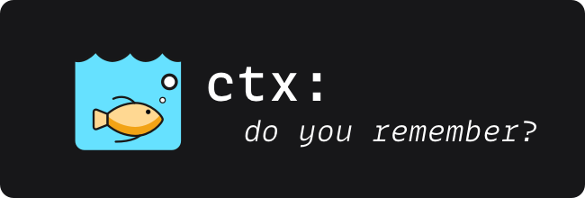

## `ctx loop`

Generate a shell script for running an autonomous loop.

An autonomous loop continuously runs an AI assistant with the
same prompt until a completion signal is detected, enabling
iterative development where the AI builds on its previous work.

```bash
ctx loop [flags]
```

**Flags**:

| Flag                    | Short | Description                                              | Default            |
|-------------------------|-------|----------------------------------------------------------|--------------------|
| `--tool <tool>`         | `-t`  | AI tool: `claude`, `aider`, or `generic`                 | `claude`           |
| `--prompt <file>`       | `-p`  | Prompt file to use                                       | `.context/loop.md` |
| `--regime <mode>`       | `-r`  | Context regime: `standard`, `eocc`, or `sac`             | `standard`         |
| `--max-turns <n>`       |       | Maximum turns per iteration (`0` = tool default; `2` for `sac` on `claude`) | `0` |
| `--max-iterations <n>`  | `-n`  | Maximum iterations (0 = unlimited)                       | `0`                |
| `--completion <signal>` | `-c`  | Completion signal to detect                              | `SYSTEM_CONVERGED` |
| `--output <file>`       | `-o`  | Output script filename                                   | `loop.sh`          |

### Semantic State Regimes (`--regime`)

- **`standard`** (default): Invokes the AI tool with the static prompt file on
  each iteration.
- **`eocc`** (End-of-Conversation Compaction): Before each iteration, the loop
  captures `ctx agent --budget 4000` (including the latest handover packet) and
  appends the EoCC contract requiring the agent to persist an updated execution
  brief (`ctx handover write --no-fold`) before exiting the iteration.
- **`sac`** (Single-Action Compaction / SSSM cycle): Injects the
  `ctx agent --budget 4000` state packet and enforces a single-action cycle
  (execute one action, observe its outcome, persist the updated semantic state
  via `ctx handover write --no-fold`, and exit). When `--tool claude` is used
  and `--max-turns` is not explicitly set, `--max-turns` defaults to `2`.

**Examples**:

```bash
# Generate loop.sh for Claude Code
ctx loop

# Generate an EoCC loop with semantic state carry-over
ctx loop --regime eocc --max-iterations 10

# Generate a Single-Action Compaction (SAC) loop
ctx loop --regime sac --max-iterations 25

# Generate for Aider with custom prompt
ctx loop --tool aider --prompt TASKS.md

# Limit to 10 iterations
ctx loop --max-iterations 10

# Output to custom file
ctx loop -o my-loop.sh
```

**Running the generated loop**:

```bash
ctx loop
chmod +x loop.sh
./loop.sh
```

**See also**: [Autonomous Loops](../operations/autonomous-loop.md)
for the full workflow.
