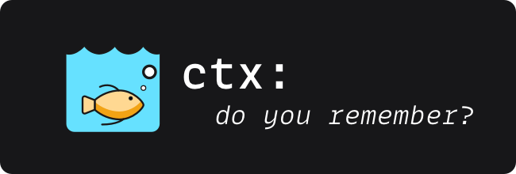

## Adopting `ctx` in Existing Projects

!!! tip "Claude Code User?"
    You probably want the plugin instead of this page.

    Install `ctx` from the marketplace:<br />
    (*`/plugin` → search "`ctx`" → Install*)<br />
    and you're done: hooks, skills, and updates are handled for you.

    See [Getting Started](../home/getting-started.md) for the full walkthrough.

This guide covers adopting `ctx` in existing projects regardless of
which tools your team uses.

## Quick Paths

| You have...                          | Command                                           | What happens                                         |
|--------------------------------------|---------------------------------------------------|------------------------------------------------------|
| Nothing (*greenfield*)               | `ctx init`                                        | Creates `.context/`, `AGENTS.md`, `CLAUDE.md`, permissions |
| Existing `AGENTS.md` or `CLAUDE.md`  | `ctx init --merge`                                | Backs up the file, inserts the `ctx` block after its H1 |
| Existing file + `ctx` markers        | `ctx init --reset`                                | Replaces the `ctx` block, leaves your content intact |
| `.cursorrules` / `.aider.conf.yml`   | `ctx init`                                        | `ctx` ignores those files: they coexist cleanly      |
| Team repo, first adopter             | `ctx init --merge && git add .context/ AGENTS.md CLAUDE.md` | Initialize and commit for the team         |

---

## Existing `AGENTS.md` or `CLAUDE.md`

This is the most common scenario:

You have an `AGENTS.md` or `CLAUDE.md` with project-specific instructions and
don't want to 
lose them.

`ctx` writes its instructions to `AGENTS.md`, the file Claude Code, Codex,
Copilot, Cursor and other agents read, between `<!-- ctx:agents -->` and
`<!-- ctx:agents:end -->`. `CLAUDE.md` gets a much smaller block between
`<!-- ctx:context -->` and `<!-- ctx:end -->`: an `@AGENTS.md` import that
makes Claude Code load the same text (a `CLAUDE.md` without it would make
Claude Code ignore `AGENTS.md` altogether). Both files are handled the same
way below.

!!! tip "You Own Both Files"
    **After initialization, `AGENTS.md` and `CLAUDE.md` are yours: edit them
    freely**.

    Add project instructions, remove sections you don't need, reorganize as 
    you see fit.

    The only parts `ctx` manages are the blocks between the markers
    (`<!-- ctx:agents -->` ... `<!-- ctx:agents:end -->` in `AGENTS.md`,
    `<!-- ctx:context -->` ... `<!-- ctx:end -->` in `CLAUDE.md`); everything
    outside those markers is yours to change at any time.

    If you remove the markers, nothing breaks: `ctx` simply treats the file 
    as having no `ctx` content and will offer to merge again on the next 
    `ctx init`.


### What `ctx init` Does

When `ctx init` detects an existing `AGENTS.md` or `CLAUDE.md`, it checks the
file for its `ctx` markers:

| State                      | Default behavior         | With `--merge`            | With `--force`                  |
|----------------------------|--------------------------|---------------------------|---------------------------------|
| No file                    | Creates from template    | Creates from template     | Creates from template           |
| Exists, no `ctx` markers   | **Prompts** to merge     | Auto-merges (*no prompt*) | Auto-merges (*no prompt*)       |
| Exists, has `ctx` markers  | Skips (*already set up*) | Skips                     | Replaces the `ctx` block only   |

### The `--merge` Flag

`--merge` auto-merges without prompting. The merge process:

1. **Backs up** the existing file to `<file>.<timestamp>.bak`;
2. **Finds the H1 heading** (e.g., `# My Project`) in your file;
3. **Inserts** the `ctx` block immediately after it;
4. **Preserves** everything else untouched.

Your content before and after the `ctx` block remains exactly as it was.

### Before / After Example

**Before**: your existing `AGENTS.md`:

```markdown
# My Project

## Build Commands

-`npm run build`: production build
- `npm test`: run tests

## Code Style

- Use TypeScript strict mode
- Prefer named exports
```

**After** `ctx init --merge`:

```markdown
# My Project

<!-- ctx:agents -->
<!-- DO NOT REMOVE: This marker indicates ctx-managed content -->

## IMPORTANT: You Have Persistent Memory

This project uses Context (`ctx`) for context persistence across sessions.
...

<!-- ctx:agents:end -->

## Build Commands

- `npm run build`: production build
- `npm test`: run tests

## Code Style

- Use TypeScript strict mode
- Prefer named exports
```

Your build commands and code style sections are untouched. The `ctx` block sits
between markers and can be updated independently.

Your `CLAUDE.md`, if you have one, receives only the bridge:

```markdown
# My Project

<!-- ctx:context -->
<!-- DO NOT REMOVE: This marker indicates ctx-managed content -->
<!-- ctx keeps the agent instructions in AGENTS.md, the open standard
     read by Claude Code, Codex, Copilot, Cursor and others; the line
     below imports them into Claude Code. -->
@AGENTS.md
<!-- ctx:end -->

## Build Commands
...
```

### The `--force` Flag

If your `AGENTS.md` or `CLAUDE.md` already has `ctx` markers (from a previous
`ctx init`), the default behavior is to skip it. Use `--force` to replace the `ctx` block with the
latest template: This is useful after **upgrading** `ctx`:

```bash
ctx init --reset
```

This only replaces the content between the markers. Your own content outside
them is preserved. A timestamped backup is created before any changes.

Upgrading from a `ctx` release that wrote the full instructions into
`CLAUDE.md`? The same command moves them: the old `CLAUDE.md` block becomes
the `@AGENTS.md` import and `AGENTS.md` is created with the instructions.

### Undoing a Merge

Every merge creates a backup:

```bash
$ ls AGENTS.md*.bak CLAUDE.md*.bak
AGENTS.md.1738000000.bak
CLAUDE.md.1738000000.bak
```

To restore:

```bash
cp AGENTS.md.1738000000.bak AGENTS.md
cp CLAUDE.md.1738000000.bak CLAUDE.md
```

Or if you are using `git`, simply:

```bash
git checkout AGENTS.md CLAUDE.md
```

---

## Existing `.cursorrules` / Aider / Copilot

`ctx` doesn't touch tool-specific config files. It creates its own files
(`.context/`, `AGENTS.md`, `CLAUDE.md`) and coexists with whatever you already
have.

### What Does `ctx` Create?

| `ctx` creates                                                                               | `ctx` does NOT touch              |
|---------------------------------------------------------------------------------------------|-----------------------------------|
| `.context/` directory                                                                       | `.cursorrules`                    |
| `CLAUDE.md` (*or merges into*)                                                              | `.aider.conf.yml`                 |
| `.claude/settings.local.json` (*seeded by `ctx init`; the plugin manages hooks and skills*) | `.github/copilot-instructions.md` |
| `AGENTS.md` (*or merges into*)                                                              | `.windsurfrules`                  |
|                                                                                             | Any other tool-specific config    |

Claude Code hooks and skills are provided by the **`ctx` plugin**,
installed from the Claude Code marketplace (`/plugin` → search "`ctx`" → Install).

### Running `ctx` Alongside Other Tools

The `.context/` directory is the source of truth. Tool-specific configs point
to it:

- **Cursor**: Reference `.context/` files in your system prompt
  (*see [Cursor setup](integrations.md#cursor-ide)*)
- **Aider**: Add `.context/` files to the `read:` list in `.aider.conf.yml`
  (*see [Aider setup](integrations.md#aider)*)
- **Copilot**: Keep `.context/` files open or reference them in comments
  (*see [Copilot setup](integrations.md#github-copilot)*)

You can generate a tool-specific configuration with:

```bash
ctx setup cursor    # Generate Cursor config snippet
ctx setup aider     # Generate .aider.conf.yml
ctx setup copilot   # Generate Copilot tips
ctx setup windsurf  # Generate Windsurf config
```

### Migrating Content into `.context/`

If you have project knowledge scattered across `.cursorrules` or custom
prompt files, consider migrating it:

1. **Rules / invariants** → `.context/CONSTITUTION.md`
2. **Code patterns** → `.context/CONVENTIONS.md`
3. **Architecture notes** → `.context/ARCHITECTURE.md`
4. **Known issues / tips** → `.context/LEARNINGS.md`

You don't need to delete the originals: `ctx` and tool-specific files
can coexist. But centralizing in `.context/` means every tool gets the
same context.

---

## Team Adoption

### `.context/` Is Designed to Be Committed

The context files (tasks, decisions, learnings, conventions, architecture)
are meant to live in version control. However, some subdirectories are
personal or sensitive and should **not** be committed.

`ctx init` automatically adds these `.gitignore` entries:

```gitignore
# Journals contain full session transcripts: personal, potentially large
.context/journal/
.context/journal-site/
.context/journal-obsidian/

# Legacy encryption key path (copy to ~/.ctx/.ctx.key if needed)
.context/.ctx.key

# Runtime state and logs (ephemeral, machine-specific):
.context/state/
.context/logs/

# Claude Code local settings (machine-specific)
.claude/settings.local.json
```

With those in place, committing is straightforward:

```bash
# One person initializes
ctx init --merge

# Commit context files (journals and keys are already gitignored)
git add .context/ AGENTS.md CLAUDE.md
git commit -m "Add ctx context management"
git push
```

Teammates pull and immediately have context. No per-developer setup needed.

### What about `.claude/`?

The `.claude/` directory contains permissions that `ctx init` seeds.
Hooks and skills are provided by the `ctx` plugin (*not per-project files*).

| File                           | Commit? | Why                                                          |
|--------------------------------|---------|--------------------------------------------------------------|
| `.claude/settings.local.json`  | No      | Machine-specific, accumulates session permissions            |
| `.claude/settings.golden.json` | Yes     | Curated permission snapshot (via `ctx permission snapshot`) |

### Merge Conflicts in Context Files

Context files are plain Markdown. Resolve conflicts the same way you would
for any other documentation file:

```bash
# After a conflicting pull
git diff .context/TASKS.md    # See both sides
# Edit to keep both sets of tasks, then:
git add .context/TASKS.md
git commit
```

Common conflict scenarios:

- **TASKS.md**: Two people added tasks: Keep both.
- **DECISIONS.md**: Same decision recorded differently: Unify the entry.
- **LEARNINGS.md**: Parallel discoveries: Keep both, remove duplicates.

### Gradual Adoption

You don't need the whole team to switch at once:

1. One person runs `ctx init --merge` and commits;
2. `AGENTS.md` works immediately for Claude Code, Codex, Copilot, Cursor and
   every other agent that reads it (`CLAUDE.md` imports it for Claude Code);
3. Other tool users can adopt at their own pace using `ctx setup <tool>`;
4. Context files benefit everyone who reads them, even without tool integration.

---

## Verifying It Worked

### Check Status

Run subsequent commands from the project root (the directory that
holds `.context/` and `.git/`); `ctx` reads `$PWD/.context/`.

```bash
ctx status
```

You should see your context files listed with token counts and no warnings.

### Test Memory

Start a new AI session and ask: **"Do you remember?"**

The AI should cite specific context:

* Current tasks from `.context/TASKS.md`;
* Recent decisions or learnings;
* Session history (*if you've had prior sessions*);

If it responds with generic "*I don't have memory*", check that `ctx` is in
your PATH (`which ctx`) and that hooks are configured
(see [Troubleshooting](integrations.md#troubleshooting)).

### Verify the Merge

If you used `--merge`, check that your original content is intact:

```bash
# Your original content should still be there
cat AGENTS.md

# The ctx block should be between markers, and CLAUDE.md should import it
grep -c "<!-- ctx:agents -->" AGENTS.md  # Should print 1
grep -c "ctx:agents:end" AGENTS.md       # Should print 1
grep -c "@AGENTS.md" CLAUDE.md            # Should print 1
```

---

## Further Reading

* [Getting Started](../home/getting-started.md): Full setup walkthrough
* [Context Files](../home/context-files.md): What each `.context/` file does
* [Integrations](integrations.md): Per-tool setup (*Claude Code, Cursor, Aider, Copilot*)
* [CLI Reference](../cli/index.md): All `ctx` commands and flags
